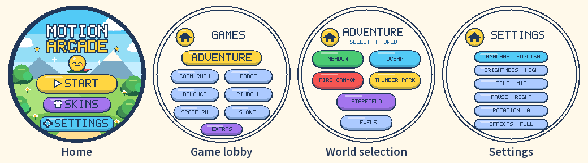
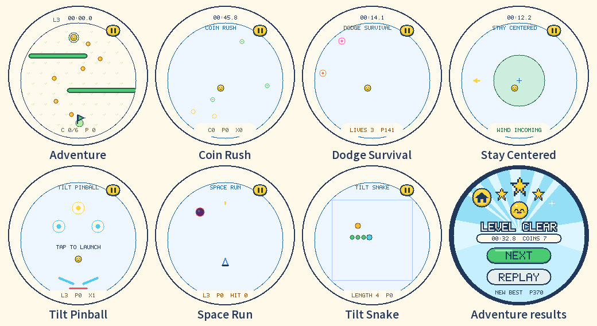

<h1 align="center">XIAO Motion Arcade</h1>

<p align="center">
  Seven tilt-and-touch games for the <strong>XIAO STM32C5</strong> and <strong>Round Display for XIAO</strong>.<br>
  Tilt to steer with the onboard IMU, then tap the 240 × 240 screen to launch a pinball or fire in space.
</p>

<p align="center">
  <a href="https://www.seeedstudio.com/"></a>
  <a href="https://www.seeedstudio.com/XIAO-STM32C5-p-7011.html"></a>
  <a href="https://www.seeedstudio.com/1-28-Round-Touch-Display-for-Seeed-Studio-XIAO-ESP32.html"></a>
  <a href="https://registry.platformio.org/tools/platformio/toolchain-gccarmnoneeabi"></a>
  <a href="https://platformio.org/"></a>
  <a href="https://docs.zephyrproject.org/latest/"></a>
</p>

<p align="center">
  <a href="firmware/latest/tilt_maze_v2.0.3.uf2?raw=true"></a>
  <a href="firmware/history/"></a>
  <a href="enclosure/"></a>
  <a href="LICENSE"></a>
</p>

<p align="center">
  <strong><a href="#quick-start">Quick start</a> · <a href="#hardware">Hardware</a> · <a href="#games">Games</a> · <a href="#build-from-source">Build from source</a></strong>
</p>

<p align="center">
  
  <a href="README_CN.md"></a>
</p>



## Hardware

| Part | What it does | Seeed Studio Bazaar |
| --- | --- | --- |
| **XIAO STM32C5** | Runs the Zephyr firmware. Its onboard LSM6DS3TR-C supplies the tilt input. | [Standard](https://www.seeedstudio.com/XIAO-STM32C5-p-7011.html) · [Pre-soldered](https://www.seeedstudio.com/XIAO-STM32C5-Pre-Solder-p-7012.html) |
| **Round Display for XIAO** | Provides a 1.28-inch, 240 × 240 color touch screen. | [Round Display for XIAO](https://www.seeedstudio.com/1-28-Round-Touch-Display-for-Seeed-Studio-XIAO-ESP32.html) |
| **USB-C data cable** | Powers the XIAO and transfers the UF2 file. | |

The boards plug together through the XIAO headers. A USB-C data connection is sufficient to play. See [XIAO STM32C5 Getting Started](https://wiki.seeedstudio.com/xiao_stm32c5_getting_started/) and the [Round Display guide](https://wiki.seeedstudio.com/get_start_round_display/) for board orientation and hardware details.

## Quick start

1. Align the XIAO headers with the Round Display and connect the XIAO to your computer with a USB-C data cable. Switch the display on.
2. Download [`tilt_maze_v2.0.3.uf2`](firmware/latest/tilt_maze_v2.0.3.uf2?raw=true).
3. Quickly press the XIAO's **RESET** button twice. Copy the UF2 to the **XIAOC5BOOT** drive that appears. The board reboots into the arcade. See [Seeed's UF2 instructions](https://wiki.seeedstudio.com/xiao_stm32c5_getting_started/#bootloader-usage).
4. Tap **START** and choose a game. Leave the unit face up on a flat surface while the IMU calibrates. In **ADVENTURE**, tapping a world starts its first stage directly. Use **LEVELS** to replay a specific stage.
5. The first row in **SETTINGS** switches between **English** and **简体中文**. Tap the house in the upper left to return home. During a game, pause first, tap the house, then confirm **QUIT**.

## Games



| Game | How to play |
| --- | --- |
| **Adventure** | Roll to the green flag across 25 stages in five themed worlds. Collect coins, use items, and earn up to three stars per stage. |
| **Coin Rush** | Collect as many coins as you can in 60 seconds. Chain pickups for a multiplier and avoid roaming hazards. |
| **Dodge Survival** | Steer around moving hazards and keep your three lives for as long as possible. |
| **Stay Centered** | Keep the ball inside a shrinking ring while gusts push it off course. |
| **Tilt Pinball** | Tap to launch or flip, then tilt to steer the ball toward the bumpers. |
| **Space Run** | Tilt to fly, tap or hold to fire at asteroids, and pick up shields and bonuses. |
| **Tilt Snake** | Eat food and avoid the walls and your own tail. Choose classic four-direction steering or free turning. |

**EXTRAS** contains seeded random runs, daily runs, and achievements. Set the date in **CHALLENGES** to choose the daily maze. Adventure and challenge coins enter your wallet when you finish a stage. In **SKINS**, **BUY** purchases and equips a skin, and **EQUIP** switches to one you own. Language, scores, progress, and other preferences are stored on the XIAO.

The images show V2.0.3 frames generated by the firmware's host renderer.

## Printable enclosure

The optional **Round 45 V5** enclosure consists of the [lower shell](enclosure/01_lower_shell.stl), [upper shell](enclosure/02_upper_shell.stl), and [display power slider](enclosure/03_display_power_slider.stl). Import the STL files in millimeters. Check the button and slider fit with your boards before closing the shell.

## Build from source

Install [PlatformIO](https://platformio.org/install) and Seeed's board platform, then build from the repository root. The [board setup guide](https://wiki.seeedstudio.com/xiao_stm32c5_getting_started/#getting-started-with-platformio) covers the first-time Zephyr toolchain setup.

```sh
pio pkg install -g -p "https://github.com/Seeed-Studio/platform-seeedboards.git"
pio run -e seeed-xiao-stm32c5
```

The build produces `.pio/tilt-maze/seeed-xiao-stm32c5/firmware.uf2`. Flash it with the same RESET and USB-drive procedure. The USB CDC monitor uses `115200` baud.

| Interface | Firmware configuration |
| --- | --- |
| GC9A01 display | SPI3, D8 SCK, D10 MOSI, D1 CS, D3 DC, D6 backlight |
| CHSC6X touch | I²C1 at address `0x2E`, D4 SDA, D5 SCL, D7 interrupt |
| Onboard LSM6DS3TR-C | I²C2 at address `0x6A`, PB3 SCL, PB4 SDA |

The [Zephyr overlay](zephyr/app.overlay) describes the round display connections. The [level table](src/levels.c) defines the mazes. [Host tests](test/host.c) cover routes, game logic, language switching in the renderer, and partial redraws.

```sh
gcc -std=c11 -O2 -Wall -Wextra -Werror -Isrc test/host.c src/maze.c src/levels.c src/art.c src/arcade.c src/adventure.c src/challenge.c -lm -o arcade-host
./arcade-host
```

## Version history

| Version | What changed |
| --- | --- |
| [V2.0.3](firmware/latest/tilt_maze_v2.0.3.uf2?raw=true) | Added English and Simplified Chinese, with a language selector in Settings and persistent language preference. |
| [V2.0.2](firmware/history/tilt_maze_v2.0.2.uf2?raw=true) | Added the upper-left house and skin-page back icons with larger touch targets. |
| [V2.0.1](firmware/history/tilt_maze_v2.0.1.uf2?raw=true) | Introduced the Colorful Adventure art, themed worlds, and animated ball expressions. |
| [V2.0](firmware/history/tilt_maze_v2.0.uf2?raw=true) | Added Pinball, Space Run, Snake, and gameplay settings. World selection starts play directly, and all adventure stages are available. |
| [V1.3.1](firmware/history/tilt_maze_v1.3.1.uf2?raw=true) | Enlarged the world and home buttons on the adventure level selector. |
| [V1.3](firmware/history/tilt_maze_v1.3.uf2?raw=true) | Added five worlds, 25 stages, stars, achievements, six skins, seeded and daily challenges, and persistent progress. |
| [V1.2](firmware/history/tilt_maze_v1.2.uf2?raw=true) | Added Coin Rush, Dodge Survival, and Stay Centered with separate records. |
| [V1.1.1](firmware/history/tilt_maze_v1.1.1.uf2?raw=true) | Added return-to-home navigation and exit confirmation from pause. |
| [V1.1](firmware/history/tilt_maze_v1.1.uf2?raw=true) | Expanded the maze to 13 stages with moving obstacles, coins, and items. |
| [V1.0](firmware/history/tilt_maze_v1.0.uf2?raw=true) | Initial tilt maze with touchscreen navigation and IMU calibration. |

V2.0.3 imports supported saves from earlier versions. The current UF2 is in [`firmware/latest/`](firmware/latest/). Earlier builds are in [`firmware/history/`](firmware/history/).

## License

The project source, original artwork, and enclosure files are distributed under the [MIT License](LICENSE). The bundled Simplified Chinese bitmap glyph subset is derived from Noto Sans SC under the [SIL Open Font License 1.1](OFL-NotoSansSC.txt).
