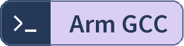
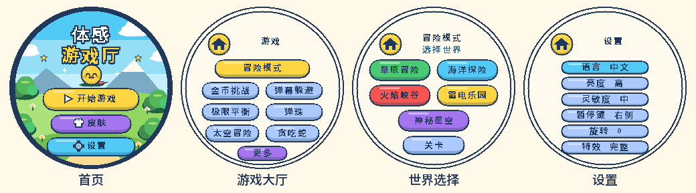
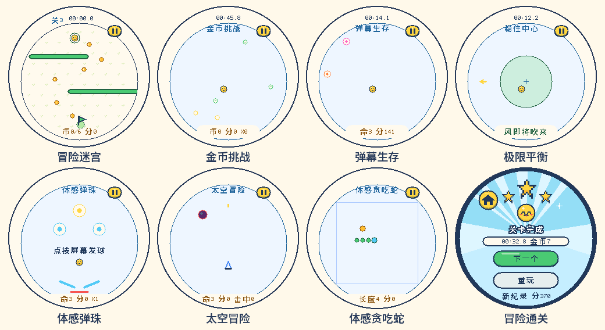

<h1 align="center">XIAO Motion Arcade · 体感游戏厅</h1>

<p align="center">
  为 <strong>XIAO STM32C5</strong> 和 <strong>Round Display for XIAO</strong> 制作的七合一掌上游戏。<br>
  倾斜设备控制小球、飞船或贪吃蛇，触摸 240 × 240 圆屏选择游戏、发射弹珠或射击。
</p>

<p align="center">
  <a href="https://www.seeedstudio.com/"></a>
  <a href="https://www.seeedstudio.com/XIAO-STM32C5-p-7011.html"></a>
  <a href="https://www.seeedstudio.com/1-28-Round-Touch-Display-for-Seeed-Studio-XIAO-ESP32.html"></a>
  <a href="https://registry.platformio.org/tools/platformio/toolchain-gccarmnoneeabi"></a>
  <a href="https://platformio.org/"></a>
  <a href="https://docs.zephyrproject.org/latest/"></a>
</p>

<p align="center">
  <a href="https://www.amazon.com/dp/B0GHYQ3HFG"></a>
  <a href="https://www.amazon.com/dp/B096SVL65V"></a>
</p>

<p align="center">
  <a href="firmware/latest/tilt_maze_v2.0.3.uf2?raw=true"></a>
  <a href="firmware/history/"></a>
  <a href="enclosure/"></a>
  <a href="LICENSE"></a>
</p>

<p align="center">
  <strong><a href="#快速开始">快速开始</a> · <a href="#硬件准备">硬件准备</a> · <a href="#七种玩法">七种玩法</a> · <a href="#从源码构建">从源码构建</a></strong>
</p>

<p align="center">
  <a href="README.md"></a>
  
</p>



## 硬件准备

| 硬件 | 用途 | 购买链接 |
| --- | --- | --- |
| **XIAO STM32C5** | 运行 Zephyr 固件。板载 LSM6DS3TR-C 用来检测倾斜。 | Seeed Studio Bazaar · [普通版](https://www.seeedstudio.com/XIAO-STM32C5-p-7011.html) · [预焊排针版](https://www.seeedstudio.com/XIAO-STM32C5-Pre-Solder-p-7012.html) |
| **Round Display for XIAO** | 提供 1.28 英寸、240 × 240 的彩色触摸界面。 | [Seeed Studio Bazaar](https://www.seeedstudio.com/1-28-Round-Touch-Display-for-Seeed-Studio-XIAO-ESP32.html) |
| **USB-C 数据线** | 给 XIAO 供电并传输 UF2。 | |
| **3.7 V 可充电锂电池**（可选） | 用于便携供电。圆屏配有 JST 1.25 mm 电池接口。 | [Amazon](https://www.amazon.com/dp/B0GHYQ3HFG) |
| **CR927 纽扣电池**（可选） | 为圆屏的实时时钟（RTC）提供备用电源。 | [Amazon](https://www.amazon.com/dp/B096SVL65V) |

两块板通过 XIAO 排针相连，接 USB-C 即可游玩。排针方向和硬件说明可查阅 [XIAO STM32C5 入门](https://wiki.seeedstudio.com/xiao_stm32c5_getting_started/) 和 [圆屏使用指南](https://wiki.seeedstudio.com/get_start_round_display/)。

## 快速开始

1. 按排针方向把 XIAO 插到圆屏上，打开圆屏开关，用 USB-C 数据线将 XIAO 接入电脑。
2. 下载 [`tilt_maze_v2.0.3.uf2`](firmware/latest/tilt_maze_v2.0.3.uf2?raw=true)。
3. 快速按两次 **RESET**，将 UF2 复制到出现的 **XIAOC5BOOT** 磁盘。板子烧录后会重启。可查看 [Seeed 的 UF2 烧录说明](https://wiki.seeedstudio.com/xiao_stm32c5_getting_started/#bootloader-usage)。
4. 点 **开始游戏** 选择玩法，首次校准时把设备正面朝上放平。进入 **冒险模式** 后，点世界名称即可从该世界第一关开玩。想单独体验某一关，可点 **关卡**。
5. 在 **设置** 第一行切换 **English / 简体中文**。点左上角房屋图标可回首页。游玩中先暂停，再点房屋图标并确认 **退出**。

## 七种玩法



| 游戏 | 操作 |
| --- | --- |
| **冒险迷宫** | 五个世界共 25 关。滚向绿色旗帜，沿途拾取金币、使用道具，每关最多获得三星。 |
| **金币挑战** | 60 秒内尽量收集金币，连续拾取会获得倍率，同时注意移动障碍。 |
| **弹幕生存** | 控制小球躲避弹幕，利用三条命坚持更久。 |
| **极限平衡** | 在阵风干扰下把小球留在不断缩小的安全圈内。 |
| **体感弹珠** | 点按屏幕发球或控制挡板，倾斜设备让弹珠命中得分柱。 |
| **太空冒险** | 倾斜操控飞船，点按或长按射击，收集护盾和奖励。 |
| **体感贪吃蛇** | 吃食物增长并避开墙和蛇身，可选经典四方向或自由转向。 |

从 **更多** 进入随机挑战、每日挑战和成就。每日迷宫取决于在 **挑战** 页面所设日期。冒险和挑战通关后，拾取的金币会进入钱包。在 **皮肤** 页面点 **购买** 可立即装备新皮肤，已拥有的皮肤可点 **装备** 切换。语言、成绩、进度和设置都保存在 XIAO 上。

图片为 V2.0.3 固件绘制代码生成的主机渲染画面。

## 3D 打印外壳

在 Bambu Studio 中打开 [3MF 工程](enclosure/round_display.3mf)，即可载入三个零件以及原排版和切片设置。使用其他切片软件时，可以按毫米导入各零件的 STL。STEP 是由同一份 3MF 网格转换而来的多面实体，可导入 CAD 软件。

| 零件 | 打印用 STL | CAD 用 STEP |
| --- | --- | --- |
| 下壳 | [STL](enclosure/01_lower_shell.stl) | [STEP](enclosure/01_lower_shell.step) |
| 上壳 | [STL](enclosure/02_upper_shell.stl) | [STEP](enclosure/02_upper_shell.step) |
| 圆屏电源滑块 | [STL](enclosure/03_display_power_slider.stl) | [STEP](enclosure/03_display_power_slider.step) |

单件文件保留 3MF 中各零件的朝向，已在 XY 平面居中并将底面落在 Z = 0。合壳前可先确认外壳按键和电源滑块与实物配合顺畅。

## 从源码构建

安装 [PlatformIO](https://platformio.org/install) 和 Seeed 板卡平台后，在仓库根目录执行以下命令。首次安装 Zephyr 工具链可参考 [XIAO STM32C5 PlatformIO 指南](https://wiki.seeedstudio.com/xiao_stm32c5_getting_started/#getting-started-with-platformio)。

```sh
pio pkg install -g -p "https://github.com/Seeed-Studio/platform-seeedboards.git"
pio run -e seeed-xiao-stm32c5
```

生成的固件位于 `.pio/tilt-maze/seeed-xiao-stm32c5/firmware.uf2`，仍可用双击 RESET 后复制到磁盘的方式烧录。USB CDC 串口波特率为 `115200`。

| 接口 | 固件配置 |
| --- | --- |
| GC9A01 屏幕 | SPI3，D8 为 SCK，D10 为 MOSI，D1 为 CS，D3 为 DC，D6 控制背光 |
| CHSC6X 触摸 | I²C1，地址 `0x2E`，D4 为 SDA，D5 为 SCL，D7 为中断 |
| 板载 LSM6DS3TR-C | I²C2，地址 `0x6A`，PB3 为 SCL，PB4 为 SDA |

[Zephyr overlay](zephyr/app.overlay) 描述圆屏连接。[关卡说明](docs/LEVELS.md) 列出了五个世界的关卡和机关配置。[主机测试](test/host.c) 覆盖关卡通路、游戏规则、语言切换和局部重绘。

```sh
gcc -std=c11 -O2 -Wall -Wextra -Werror -Isrc test/host.c src/maze.c src/levels.c src/art.c src/arcade.c src/adventure.c src/challenge.c -lm -o arcade-host
./arcade-host
```

## 版本迭代

| 版本 | 更新内容 |
| --- | --- |
| [V2.0.3](firmware/latest/tilt_maze_v2.0.3.uf2?raw=true) | 增加英文和简体中文，可在设置中切换并保存语言。 |
| [V2.0.2](firmware/history/tilt_maze_v2.0.2.uf2?raw=true) | 增加左上角房屋键和皮肤页返回箭头，扩大触摸区。 |
| [V2.0.1](firmware/history/tilt_maze_v2.0.1.uf2?raw=true) | 改用 Colorful Adventure 主题，加入五个世界配色和小球表情。 |
| [V2.0](firmware/history/tilt_maze_v2.0.uf2?raw=true) | 新增弹珠、太空冒险、贪吃蛇和游戏设置。点世界直接开玩，全部冒险关卡可选。 |
| [V1.3.1](firmware/history/tilt_maze_v1.3.1.uf2?raw=true) | 放大选关页的世界切换和返回首页按钮。 |
| [V1.3](firmware/history/tilt_maze_v1.3.uf2?raw=true) | 新增五个世界、25 关、三星评价、成就、六款皮肤、随机与每日挑战及本地存档。 |
| [V1.2](firmware/history/tilt_maze_v1.2.uf2?raw=true) | 加入金币挑战、弹幕生存和极限平衡，并记录各模式最佳成绩。 |
| [V1.1.1](firmware/history/tilt_maze_v1.1.1.uf2?raw=true) | 增加暂停后返回首页和退出确认。 |
| [V1.1](firmware/history/tilt_maze_v1.1.uf2?raw=true) | 将迷宫扩展到 13 关，增加移动机关、金币和道具。 |
| [V1.0](firmware/history/tilt_maze_v1.0.uf2?raw=true) | 初版体感迷宫，含触摸导航和 IMU 校准。 |

V2.0.3 支持导入兼容的历史存档。最终固件放在 [`firmware/latest/`](firmware/latest/)，历代固件放在 [`firmware/history/`](firmware/history/)。

## 开源许可

项目源代码、原创美术和外壳文件采用 [MIT License](LICENSE)。随固件分发的简体中文点阵字形来自 Noto Sans SC，适用 [SIL Open Font License 1.1](OFL-NotoSansSC.txt)。
